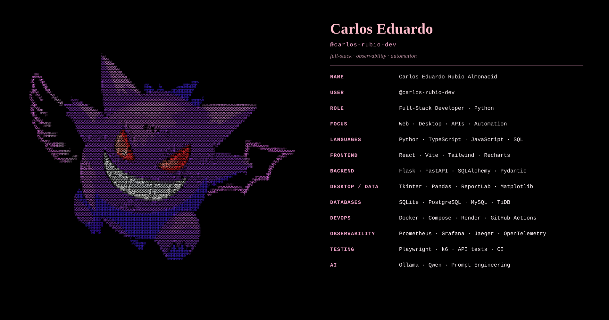

  

<h2 align="center">Hola, soy Carlos Eduardo Rubio Almonacid 👋</h2>

  Soy desarrollador de software junior. He trabajado en aplicaciones web y de escritorio, APIs, automatizaciones y soluciones basadas en datos.

  <a href="https://github.com/carlos-rubio-dev?tab=repositories">Ver todos mis proyectos</a>

## Lenguajes

  
  
  
  
  
  
  

## Tecnologías que he utilizado

| Área | Tecnologías |
|---|---|
| Frontend | React, Vite, Tailwind CSS, Recharts, Lucide React |
| Backend y APIs | Flask, FastAPI, SQLAlchemy, Pydantic, Gunicorn |
| Escritorio y datos | Tkinter, CustomTkinter, Pandas, OpenPyXL, ReportLab, Matplotlib |
| Bases de datos | SQLite, PostgreSQL, MySQL, TiDB Cloud |
| DevOps y nube | Docker, Docker Compose, Render, GitHub Actions |
| Observabilidad | Prometheus, Grafana, Jaeger, OpenTelemetry |
| Pruebas y rendimiento | Playwright, k6, pruebas de API y CI |
| IA y automatización | Ollama, Qwen, ingeniería de prompts y flujos con agentes |

## Herramientas

  
  
  
  
  
  
  
  
  
  

## Proyectos destacados

| Proyecto | Qué contiene |
|---|---|
| [BoviControl Pro](https://github.com/carlos-rubio-dev/bovicontrol-pro) | Aplicación full stack con React, TypeScript, Flask, SQLite/MySQL, pruebas Playwright y despliegue en Render/TiDB. |
| [Laboratorio APM](https://github.com/carlos-rubio-dev/taller-laboratorio-4-apm) | API FastAPI dockerizada con PostgreSQL, Prometheus, Grafana, Jaeger, OpenTelemetry y pruebas de carga con k6. |
| [CafeFET](https://github.com/carlos-rubio-dev/taller-cafefet) | Ingeniería de prompts, experimentos con Ollama y Qwen, validación y comparación de resultados. |
| VacúnateYa | Aplicación privada de escritorio para vacunación, PDF, SQLite y recordatorios por correo. |
| Migrador de vacunas | Herramienta privada para migrar datos desde Excel hacia SQLite con Pandas. |

  

